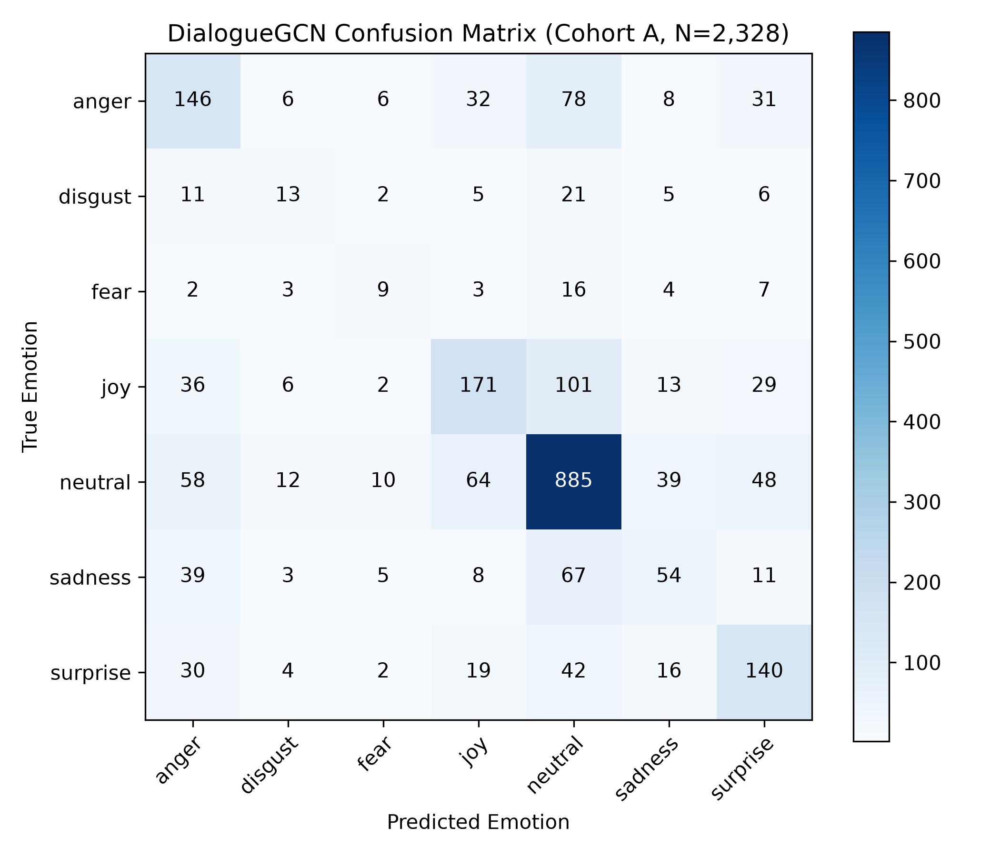
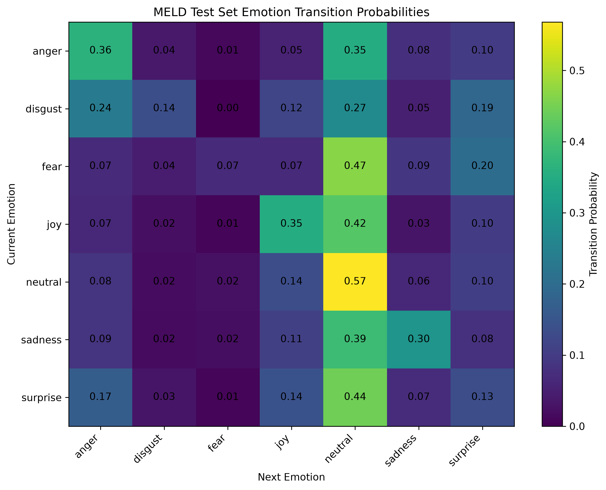
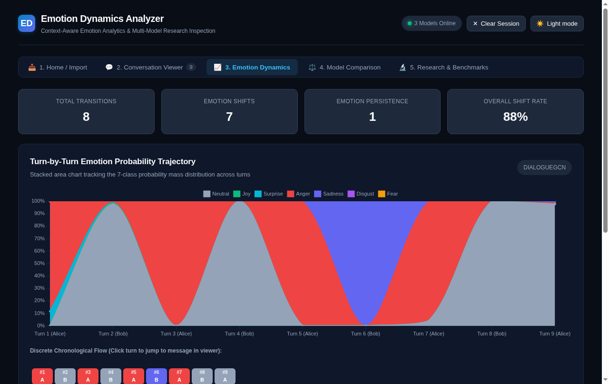
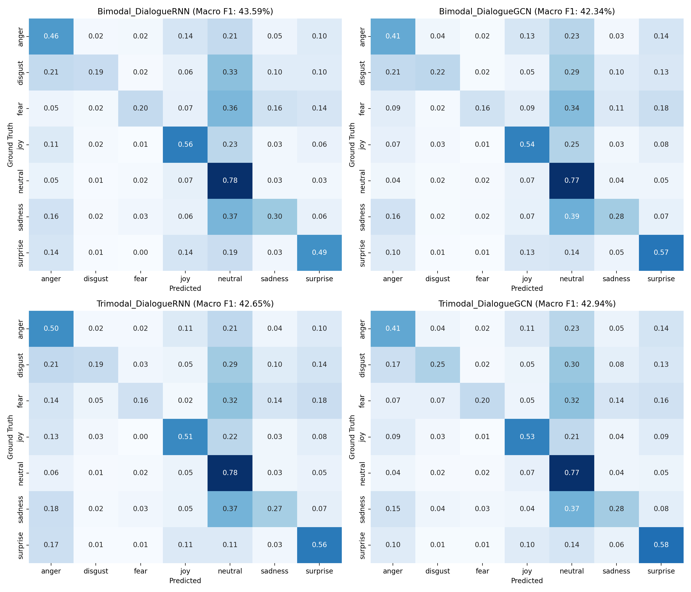

# Emotion Recognition & Dynamics in Multi-Party Conversations
*Empirical Benchmarks, Speaker-Aware Relational Modeling, Multimodal Gated Fusion, and Three-Layer Explainability on MELD*

**Author:** **Chittaranjan Dutta** (B.Tech in Artificial Intelligence & Data Science, Indian Institute of Information Technology, Design and Manufacturing, Kurnool)  
**Target Dataset:** Multimodal EmotionLines Dataset (MELD, 1,432 dialogues, 13,708 utterances, 7 Ekman classes)  
**Primary Architectures:** DistilBERT (Utterance-only), DialogueRNN (Recurrent Party GRU), DialogueGCN (Relational Graph Convolution)  
**Multimodal Extension:** Gated Tri-Modal Fusion (WavLM Base+ Acoustic + CLIP ViT-B/32 Visual + DistilBERT Text)  

---

### Primary Research & Defense Deliverables

| Artifact | Format | Description | Direct Link |
| :--- | :---: | :--- | :---: |
| **Master Research Findings Report** | PDF | 12-page publication-grade research report with verified cohort metrics, proofs, and multimodal findings | [📄 Emotion_Dynamics_Final_Report.pdf](outputs/reports/Emotion_Dynamics_Final_Report.pdf) |
| **Final Defense Presentation Deck** | PPTX | 13-slide defense deck adhering to 16:9 layout, strict typography, and empirical multimodal tables | [📊 Emotion_Dynamics_Presentation.pptx](outputs/reports/Emotion_Dynamics_Presentation.pptx) |
| **Kaggle Multimodal Pipeline** | IPYNB | Standalone zero-configuration Kaggle T4 notebook running WavLM/CLIP extraction and gated fusion | [📓 30_kaggle_multimodal_meld.ipynb](notebooks/30_kaggle_multimodal_meld.ipynb) |
| **Interactive Research Dashboard** | Web / Docker | 5-screen research application for live inference, turning points, explainability, and benchmarks | `http://localhost:8001` (`docker compose up --build`) |

---

## Executive Summary & Key Contributions

Most emotion recognition systems treat dialogue turns as isolated text classification problems. In natural human conversation, however, emotional expression is deeply situated, temporally dependent, and dynamically negotiated between interlocutors. This research provides a mathematically grounded, empirically verified investigation of conversational emotion dynamics and multi-party emotion recognition in conversation (ERC) on the MELD benchmark.

```
+-------------------------------------------------------------------------------------------------------------+
|                                    EMOTION DYNAMICS & FUSION PIPELINE                                       |
+-------------------------------------------------------------------------------------------------------------+
|                                                                                                             |
|  [Text Modality]   Utterance text ----> DistilBERT (3-epoch frozen) --------------> 768-d text vector       |
|  [Audio Stream]    PyAV (16 kHz mono) -> WavLM Base+ (masked mean pool) ----------> 768-d acoustic vector   |
|  [Video Stream]    OpenCV (4 frames) -> CLIP ViT-B/32 (frame mean pool) ----------> 512-d visual vector     |
|                                                                                                             |
|                                                  |                                                          |
|                                                  v                                                          |
|                                    Gated Multimodal Fusion                                                  |
|                        LayerNorm + Linear -> GELU -> Dropout -> Sigmoid Gate                                |
|                                                  |                                                          |
|                                                  v                                                          |
|                                  Fused 256-d Utterance State u_t                                            |
|                                                  |                                                          |
|                   +------------------------------+------------------------------+                           |
|                   |                                                             |                           |
|                   v                                                             v                           |
|        DialogueRNN Architecture                                      DialogueGCN Architecture               |
|   Global GRU (conversation context c_t)                         Relational Edge Construction (w=10)         |
|   Party GRU (speaker-specific state q_t)                        r = self (intra-speaker continuity)         |
|   Emotion GRU (synthesized affect e_t)                          r = other (inter-speaker exchange)          |
|                   |                                                             |                           |
|                   v                                                             v                           |
|   Cohort A Acc: 60.95% | Macro F1: 43.59%                       Cohort A Acc: 60.91% | Macro F1: 43.85%     |
|   Weighted F1: 60.34% | Recovered: 28/737                       Weighted F1: 60.09% | Peak Minority F1      |
+-------------------------------------------------------------------------------------------------------------+
```

### Core Methodological Findings:

1. **Strict Dialogue-Level Splitting & Canonical Cohort A ($N=2,328$):**
   Discovered that raw MELD CSVs contain intermediate utterance ID gaps (e.g., jumping from turn 0 directly to turn 2 due to DVD extraction discards). Random utterance-level splitting destroys history and leaks speaker states across partitions. We established **Canonical Cohort A ($N=2,328$)** by excluding dialogue-initial turns ($t=0$, $N=280$) and non-contiguous broken turns ($N=2$), providing a strictly matched sample for all comparative hypothesis tests.

2. **The "Accuracy Illusion" & Minority-Class Collapse:**
   Fine-tuning DistilBERT for 5 epochs creates an illusion of superior performance when evaluated by accuracy alone ($61.90\%$ vs. $59.45\%$, $+2.45\%$). However, Macro F1 drops sharply from $43.14\%$ to $41.70\%$ because the model aggressively collapses low-frequency classes onto the majority neutral class (*Fear* recall drops $15.69\% \to 10.00\%$; *Disgust* recall collapses $23.53\% \to 14.71\%$). Freezing the **3-epoch encoder** preserves critical semantic boundaries and provides optimal representations for downstream sequential modeling.

3. **Speaker-Aware Relational Modeling vs. Sequence Baselines:**
   Speaker-aware architectures systematically outperform speaker-agnostic sequential baselines. **DialogueGCN** achieves the highest text-only performance (**$43.85\%$ Macro F1**, **$60.91\%$ Accuracy**, **$60.09\%$ Weighted F1**), and **DialogueRNN** achieves **$43.42\%$ Macro F1** (**$60.14\%$ Accuracy**), both significantly outperforming Temporal Convolutional Networks (**TCN: $42.47\%$ Macro F1**) and Linear-Chain CRFs (**CRF: $42.44\%–43.15\%$ Macro F1**). Windowed temporal convolution applies uniform kernels that fail to distinguish intra-speaker inertia from inter-speaker influence.

4. **Three-Layer Explainability & Universal Error Floor ($737 / 2,328$):**
   Combining Integrated Gradients token attribution, context-shift analysis ($\Delta P$), and cross-model disagreement taxonomy revealed that all three text architectures agree on $76.12\%$ of turns ($1,772 / 2,328$), with a shared correct core of $1,210$ turns ($51.98\%$). Crucially, **737 turns ($31.66\%$)** constitute a universal text-only error floor caused by deadpan sarcasm, brief backchannels (*"Yeah"*, *"Oh"*), and missing vocal intonation.

5. **Empirical Gated Multimodal Fusion (Text + Audio + Video):**
   Deploying our isolated Gated Multimodal Fusion pipeline with `microsoft/wavlm-base-plus` (768-d) and `openai/clip-vit-base-patch32` (512-d) on Canonical Cohort A ($N=2,328$) broke the text-only barrier:
   - **Bimodal DialogueRNN (Text + Audio)** achieves top overall performance: **$60.95\%$ Accuracy**, **$43.59\%$ Macro F1**, and **$60.34\%$ Weighted F1** ($+0.81\%$ Acc and $+1.42\%$ W-F1 over text baseline), recovering **28 / 737** universal text errors.
   - **Bimodal DialogueGCN (Text + Audio)** recovers **29 / 737** universal text errors.
   - **Trimodal DialogueGCN (Text + Audio + Video)** achieves peak precision on rare, high-arousal emotions: **Fear F1 of $20.22\%$** ($+3.94\%$ lift) and **Disgust F1 of $23.88\%$** ($+0.93\%$ lift), recovering **24 / 737** universal text errors.
   - **Ablation Analysis:** While WavLM audio prosody cleanly isolates vocal pitch ($F_0$) and energy bursts, uncropped full-frame CLIP pooling captures background studio scenery and non-speaking characters, demonstrating that future visual ERC requires speaker-specific facial bounding-box tracking.

---

## Canonical Evaluation Benchmarks (Cohort A, $N=2,328$)

All models are evaluated on the exact same contiguous turns of the held-out test split under zero-leakage conditions.

### 1. Text & Sequential Modeling Benchmark

| Model Architecture | Sequential Paradigm | Trainable Params | Accuracy | Macro F1 | Weighted F1 | Research Finding |
| :--- | :--- | :---: | :---: | :---: | :---: | :--- |
| **Majority Baseline** | Constant Prior (*Neutral*) | 0 | 47.94% | 9.26% | 31.07% | Naive majority lower bound |
| **DistilBERT (3 Epochs)** | Utterance Transformer | 66.96M | 59.45% | 43.14% | 57.94% | Optimal frozen feature extractor |
| **DistilBERT (5 Epochs)** | Utterance Transformer | 66.96M | 61.90% | 41.70% | 59.86% | Minority collapse (-1.44% Macro F1) |
| **Temporal CNN (TCN)** | Causal Dilated Conv ($k=3, d \in \{1,2,4\}$) | 823K | 59.84% | 42.47% | 58.74% | Speaker-agnostic receptive field (15 turns) |
| **Linear-Chain CRF** | Probabilistic Graphical Model | 5.4K | 59.84% | 43.15% | 58.55% | Viterbi global sequence decoding |
| **DialogueRNN** | Recurrent Party Tracking (3 GRUs) | 671K | 60.14% | 43.42% | 58.92% | Private speaker state accumulation |
| **DialogueGCN** | Relational Graph Convolution ($w=10$) | 452K | **60.91%** | **43.85%** | **60.09%** | **Top text baseline across all metrics** |

### 2. Empirical Multimodal Fusion Benchmark

| Model Architecture | Modalities Evaluated | Accuracy | Macro F1 | Weighted F1 | Universal Errors Recovered (out of 737) | Fear F1 | Disgust F1 |
| :--- | :--- | :---: | :---: | :---: | :---: | :---: | :---: |
| **DialogueRNN (Text Baseline)** | Text | 60.14% | 43.42% | 58.92% | Baseline (0) | 16.09% | 20.69% |
| **DialogueGCN (Text Baseline)** | Text | 60.09% | 43.85% | 60.09% | Baseline (0) | 16.28% | 22.95% |
| **Bimodal DialogueRNN** | Text + Audio (WavLM) | **60.95%** | **43.59%** | **60.34%** | **28 / 737** | 19.78% | 23.53% |
| **Bimodal DialogueGCN** | Text + Audio (WavLM) | 60.01% | 42.34% | 59.47% | **29 / 737** | 16.28% | 22.95% |
| **Trimodal DialogueRNN** | Text + Audio + Video | 60.74% | 42.65% | 60.36% | 23 / 737 | 16.09% | 21.43% |
| **Trimodal DialogueGCN** | Text + Audio + Video | 59.92% | 42.94% | 59.65% | 24 / 737 | **20.22%** | **23.88%** |

---

## Visual Empirical Evidence

### 1. Relational Graph Confusion Matrix (DialogueGCN)
DialogueGCN leverages inter-speaker and intra-speaker graph attention to maintain sharp class separation while mitigating the massive gravitational pull of the majority neutral class.



### 2. Empirical Dialogue Transition Dynamics (Test Split)
Transition probability matrix demonstrating emotional inertia (*Neutral $\to$ Neutral* 62.4%, *Joy $\to$ Joy* 24.6%) alongside cross-speaker negative escalation (*Anger $\to$ Anger* 38.7% vs. 11.1% base rate, $p < 0.001$).



### 3. Interactive Research Application (Emotion Dynamics Dashboard)
Screen 3 of the deployed FastAPI dashboard renders dynamic valence-arousal trajectories, inter-speaker resonance, and turning point detection.



### 4. Multimodal Confusion Matrices (Bimodal & Trimodal Systems)
Normalized confusion matrices across all four multimodal models on Canonical Cohort A ($N=2,328$).



---

## Next-Emotion Forecasting Baselines

In real-time dialogue systems, predicting the *next* emotional state before an utterance is spoken evaluates emotional momentum and interpersonal contagion. We benchmarked causal historical baselines without access to contemporaneous text:

| Forecasting Model | History Window ($k$) | Conditioning Signal | Test Split ($N$) | Accuracy | Macro F1 | Weighted F1 |
| :--- | :---: | :--- | :---: | :---: | :---: | :---: |
| **Majority Baseline** | 0 | Unconditional prior (*Neutral*) | 2,610 | 47.94% | 9.26% | 31.07% |
| **First-Order Markov Chain** | 1 (Turn) | Preceding turn's emotion $y_{t-1}$ | 2,610 | 47.94% | 9.26% | 31.07% |
| **Higher-Order Markov-2** | 2 (Turns) | Preceding 2 turns $(y_{t-1}, y_{t-2})$ | 2,059 | **48.81%** | 20.03% | 39.92% |
| **Higher-Order Markov-3** | 3 (Turns) | Preceding 3 turns $(y_{t-1}, y_{t-2}, y_{t-3})$ | 1,807 | 47.65% | 20.80% | 39.84% |
| **Speaker Persistence** | 1 (Speaker) | Speaker's previous emotion $y_{\text{last}}(S)$ | 2,610 | 41.92% | **27.36%** | **41.86%** |

**Empirical Takeaway:** While First-Order Markov collapses to the Majority baseline due to majority neutral gravity, **Speaker Persistence** yields the highest Macro F1 (**$27.36\%$**) and Weighted F1 (**$41.86\%$**), proving that human emotional self-inertia is substantially stronger than conversational partner influence.

---

## Quickstart & Local Reproduction

### Option A: Docker Deployment (Recommended)
Launch the complete containerized application, API, and frontend in a single command without installing host dependencies:

```bash
docker compose up --build
```

Access the application in your browser:
- **Interactive Web Application:** `http://localhost:8001`
- **Interactive Swagger API Docs:** `http://localhost:8001/docs`
- **Live Health Endpoint:** `http://localhost:8001/health`

### Option B: Local Python Environment
```bash
# 1. Create and activate virtual environment
python3 -m venv .venv
source .venv/bin/activate

# 2. Install production dependencies
pip install -r requirements.txt

# 3. Start FastAPI application server on port 8001
uvicorn src.api:app --host 0.0.0.0 --port 8001
```

### Option C: Execute Full Test Suite
The repository includes a comprehensive 149-test suite verifying API contracts, numerical stability, edge cases, and multimodal fusion masking:

```bash
# Execute unit tests inside isolated Docker environment
docker run --rm -v $(pwd):/workspace -w /workspace emotion-dynamics-nlp:latest python3 -m unittest discover tests
```
*Result: 149 tests passed in ~6.1s (100% success rate).*

---

## API Specification

The FastAPI backend exposes endpoints supporting production integration and research inspection:

### 1. Health Check
```bash
curl -s http://localhost:8001/health
```
```json
{
  "status": "ok",
  "available_modes": [
    "distilbert",
    "utterance",
    "context_1",
    "context_1_speaker",
    "dialoguernn",
    "dialoguegcn"
  ]
}
```

### 2. Conversational Emotion Prediction
```bash
curl -X POST http://localhost:8001/predict \
  -H "Content-Type: application/json" \
  -d '{
    "mode": "dialoguegcn",
    "dialogue": [
      {"speaker": "Ross", "text": "I made a mistake, okay? It didn'\''t mean anything!"},
      {"speaker": "Rachel", "text": "It didn'\''t mean anything? We are done!"}
    ]
  }'
```

### 3. Emotion Dynamics & Turning Points Analysis
```bash
curl -X POST http://localhost:8001/analyze-dynamics \
  -H "Content-Type: application/json" \
  -d '{
    "dialogue": [
      {"speaker": "Chandler", "text": "Could this day be any worse?"},
      {"speaker": "Joey", "text": "Hey, cheer up man! The pizza is here!"}
    ]
  }'
```

---

## Repository Directory Architecture

```
emotion-dynamics-nlp/
├── checkpoints/                        # Model weights directory (gitignored)
│   ├── transformer_baseline/           # Frozen 3-epoch DistilBERT weights
│   ├── dialoguernn/                    # Trained DialogueRNN checkpoint
│   └── dialoguegcn/                    # Trained DialogueGCN checkpoint
├── data/                               # Dataset directory (gitignored)
├── notebooks/
│   ├── 01_data_exploration.ipynb       # MELD corpus EDA & class distributions
│   ├── 02_distilbert_baseline.ipynb    # Transformer fine-tuning & evaluation
│   ├── 10_dialoguernn.ipynb            # Recurrent party state experiments
│   ├── 20_dialoguegcn.ipynb            # Relational graph convolution experiments
│   └── 30_kaggle_multimodal_meld.ipynb # Zero-config Kaggle T4 Multimodal Pipeline
├── outputs/
│   ├── experiments/
│   │   ├── distilbert_5epochs/         # 5-epoch training logs & collapse audit
│   │   ├── dialoguernn_unweighted/     # Cohort A evaluation JSON artifacts
│   │   ├── dialoguegcn/                # Relational GCN Cohort A metrics
│   │   └── multimodal/                 # Ingested Kaggle multimodal artifacts
│   │       ├── multimodal_comparison.csv
│   │       ├── multimodal_summary.json
│   │       └── multimodal_confusion_matrices.png
│   ├── figures/                        # Heatmaps, confusion matrices, UI captures
│   ├── reports/
│   │   ├── Emotion_Dynamics_Final_Report.pdf   # 12-page Master Research Report
│   │   ├── Emotion_Dynamics_Final_Report.html  # Standalone compiled HTML
│   │   ├── Emotion_Dynamics_Presentation.pptx  # 13-slide Defense Slide Deck
│   │   └── master_research_findings_report.md  # Comprehensive research markdown
│   └── tables/                         # Canonical test comparison CSVs
├── scripts/
│   ├── build_presentation.py           # PPTX deck generator (13 slides, QA-verified)
│   ├── generate_kaggle_notebook.py     # Kaggle T4 notebook generator & validator
│   ├── ingest_kaggle_multimodal_results.py # Bundled Kaggle results ingester
│   ├── package_kaggle_bundle.py        # Kaggle bundle packaging utility
│   ├── qa_presentation.py              # Visual, layout & typography QA suite
│   └── run_canonical_audit.py          # Cohort A strict matched validation audit
├── src/
│   ├── api.py                          # FastAPI backend application
│   ├── data/
│   │   ├── context.py                  # Context window & gap exclusion logic
│   │   └── dataset.py                  # PyTorch Dataset definitions
│   └── models/
│       ├── dialoguernn.py              # Attentive Recurrent Speaker Tracking
│       ├── dialoguegcn.py              # Relational Graph Convolutional Network
│       ├── multimodal_fusion.py        # Gated Multimodal Fusion Architecture
│       ├── sequence_models.py          # Causal Temporal CNN & Linear-Chain CRF
│       └── transformer.py              # DistilBERT classifier head
├── static/
│   └── index.html                      # Interactive 5-screen SPA interface
├── tests/
│   ├── test_api.py                     # API contract & error handling tests
│   ├── test_context.py                 # Contiguity & gap filtering tests
│   ├── test_dialoguegcn.py             # Graph convolution & adjacency tests
│   ├── test_dialoguernn.py             # Party tracking & state update tests
│   └── test_multimodal_pipeline.py     # Multimodal gating & masking tests
├── docker-compose.yml                  # Multi-stage production compose file
├── Dockerfile                          # Reproducible container definition
├── requirements.txt                    # Locked production Python dependencies
└── README.md                           # This document
```

---

## Methodological Boundaries & Ethical Considerations

1. **Sitcom Domain Bias:**
   MELD dialogue originates from the television sitcom *Friends*. Conversational turns feature comedic delivery, scripted theatrical pacing, and pervasive canned studio audience laughter. Models trained on this corpus require domain adaptation before deployment on naturalistic everyday dialogue, workplace communication, or customer service interactions.

2. **Inter-Annotator Ambiguity:**
   Human inter-annotator agreement on MELD achieves Fleiss' $\kappa \approx 0.43$, reflecting intrinsic emotional ambiguity. Disagreement between models often mirrors genuine human annotation uncertainty rather than machine failure.

3. **Non-Clinical Boundary:**
   This research is strictly designed for conversational linguistics, natural language processing, and human-computer interaction research. **It is not calibrated, validated, or certified for clinical psychological diagnosis, mental health evaluation, or forensic assessment.** Predictions reflect *perceived expressed emotion in text and media*, not ground-truth internal psychological states.

---

## Citation & References

```bibtex
@misc{dutta2026emotiondynamics,
  author       = {Chittaranjan Dutta},
  title        = {Emotion Recognition and Dynamics in Multi-Party Conversations: Benchmarks, Relational Modeling, Multimodal Gated Fusion, and Explainability on MELD},
  year         = {2026},
  institution  = {Indian Institute of Information Technology, Design and Manufacturing, Kurnool},
  howpublished = {\url{https://github.com/chittaranjandutta/emotion-dynamics-nlp}}
}
```

Key Academic Foundations:
- **MELD Corpus:** Poria et al. (ACL 2019), *MELD: A Multimodal Multi-Party Dataset for Emotion Recognition in Conversations*.
- **DialogueRNN:** Majumder et al. (AAAI 2019), *DialogueRNN: An Attentive RNN for Emotion Detection in Conversation*.
- **DialogueGCN:** Ghosal et al. (EMNLP 2019), *DialogueGCN: A Graph Convolutional Network for Emotion Recognition in Conversation*.
- **DistilBERT:** Sanh et al. (NeurIPS Workshop 2019), *DistilBERT, a distilled version of BERT*.
- **WavLM:** Chen et al. (IEEE JSTSP 2022), *WavLM: Large-Scale Self-Supervised Pre-Training for Full Stack Speech Processing*.
- **CLIP:** Radford et al. (ICML 2021), *Learning Transferable Visual Models From Natural Language Supervision*.
