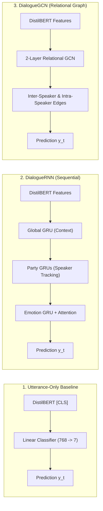

# Emotion Dynamics in Multi-Party Conversations
## Academic Research Evaluation Presentation

**Presenter:** Undergraduate NLP Research Project  
**Benchmark:** MELD (Multimodal EmotionLines Dataset — Text Modality)  
**Models:** DistilBERT Baseline, DialogueRNN (Sequential Recurrent), DialogueGCN (Relational Graph)  
**Evaluator Presentation Time:** 10–12 Minutes  

---

## Slide 1: Title & Research Motivation

### Beyond Static Classification: Emotion Dynamics in Dialogue

* **The Problem:** Traditional NLP treats emotion classification as an isolated, sentence-level task.
* **The Reality:** In multi-party conversations, an utterance's emotional meaning is inextricably linked to:
  * **Conversational Context:** Who spoke previously, and what was said?
  * **Emotional Inertia:** How a speaker's internal state carries forward across turns.
  * **Emotional Resonance:** How one interlocutor's emotion triggers or dampens another's.
* **Research Objective:** Empirically quantify the value of contextual sequence modeling (DialogueRNN) and graph-relational topology (DialogueGCN) over fine-tuned isolated transformers (DistilBERT).

---

## Slide 2: Research Questions & Core Hypotheses

```
+-------------------------------------------------------------------------------+
|                            CORE RESEARCH QUESTIONS                            |
+-----+-------------------------------------------------------------------------+
| RQ1 | Does multi-turn conversational context statistically improve ERC over   |
|     | isolated utterance classification?                                      |
+-----+-------------------------------------------------------------------------+
| RQ2 | Does relational graph topology (DialogueGCN) outperform sequential      |
|     | recurrent party tracking (DialogueRNN)?                                 |
+-----+-------------------------------------------------------------------------+
| RQ3 | Can conversational dynamics (inertia, resonance, turning points) be      |
|     | modeled causally and transparently?                                     |
+-----+-------------------------------------------------------------------------+
| RQ4 | How reliably can token-level and context-level explanations attribute   |
|     | model decisions without overclaiming psychological certainty?           |
+-----+-------------------------------------------------------------------------+
```

---

## Slide 3: Dataset Selection — The Multi-Party Challenge

### Why MELD (Multimodal EmotionLines Dataset)?

* **Authentic Group Dynamics:** 1,433 dialogues from *Friends* containing 2 to 9 concurrent speakers.
* **7 Emotion Classes:** *Neutral* (47.2%), *Joy* (17.5%), *Surprise* (12.1%), *Anger* (11.1%), *Sadness* (6.8%), *Disgust* (2.7%), *Fear* (2.7%).
* **Comparison with Alternatives:**
  * *DailyDialog:* Too heavily dominated by *Neutral* (>83%); strictly dyadic (no group dynamics).
  * *EmoWOZ:* Restricted to task-oriented wizard-of-oz customer interactions.

```
                      MELD DATASET PARTITIONS (DIALOGUE-LEVEL)
                      
       ┌────────────────────────┬─────────────┬─────────────┐
       │ Split                  │ Dialogues   │ Utterances  │
       ├────────────────────────┼─────────────┼─────────────┤
       │ Train                  │ 1,038       │ 9,989       │
       │ Development (Dev)      │ 114         │ 1,109       │
       │ Test                   │ 280         │ 2,610       │
       └────────────────────────┴─────────────┴─────────────┘
```

---

## Slide 4: Methodological Rigor — The Cohort A Matched Subset

### Resolving the "Missing ID" Gap Problem

```
                        EVALUATION COHORT FORMULATION

               Official Test Split (N = 2,610 utterances, 280 dialogues)
                                      │
              ┌───────────────────────┴───────────────────────┐
              ▼                                               ▼
   Dialogue-Initial Turns (N=280)                 Contiguous Adjacency
   Broken Utterance-ID Gaps (N=2)                 Maintained Across Turns
              │                                               │
              ▼                                               ▼
     Excluded from Context                      Canonical Cohort A (N = 2,328)
    (No preceding turn history)                (Apples-to-apples matched test)
```

* **The Problem:** MELD raw data has dropped turns (`Utterance_ID = 0` followed by `2`). Recurrent and graph models cannot legally construct causal transitions across missing data gaps.
* **The Solution:** We establish **Cohort A ($N=2,328$)** as the canonical evaluation benchmark for all comparative claims.

---

## Slide 5: Model Architectures Overview



---

## Slide 6: Verified Results on Canonical Cohort A ($N=2,328$)

```
+---------------------------------------------------------------------------------------+
|                         CANONICAL MATCHED-COHORT TEST RESULTS                         |
+------------------------------+-------------+-----------+-------------+----------------+
| Model Family                 | Accuracy    | Macro F1  | Weighted F1 | Trainable Params|
+------------------------------+-------------+-----------+-------------+----------------+
| DistilBERT Baseline (3 Ep)   | 59.45%      | 43.14%    | 57.94%      | 66,960,000     |
| DistilBERT Extended (5 Ep)   | 61.90%      | 41.70%    | 59.86%      | 66,960,000     |
| DialogueRNN (Sequential GRU) | 60.14%      | 43.42%    | 58.92%      | 670,855        |
| DialogueGCN (Relational GCN) | **60.91%**  | **43.85%**| **60.09%**  | **452,487**    |
| Temporal CNN (Causal RF=15)  | 60.27%      | 42.47%    | 59.52%      | 823,303        |
| Linear-Chain CRF (Viterbi)   | 60.01%      | 42.44%    | 59.47%      | 5,446          |
| Linear-Chain CRF (Causal)    | 60.18%      | 43.15%    | 59.63%      | 5,446          |
+------------------------------+-------------+-----------+-------------+----------------+
| Net Context Lift (GCN vs DB) | **+1.46%**  | **+0.71%**| **+2.15%**  | -66.5M params  |
+------------------------------+-------------+-----------+-------------+----------------+
```

### Key Empirical & Architectural Insights:
* **The Relational Inductive Bias Wins:** DialogueGCN achieves the highest Macro F1 (43.85%) and Accuracy (60.91%) while requiring **32% fewer parameters** than DialogueRNN and 99.3% fewer than DistilBERT.
* **Why Convolutions and CRFs Fail to Break the Ceiling:** Temporal CNNs apply uniform filter kernels across turns without distinguishing speaker identities. In multi-party conversations, explicit interlocutor graph routing (DialogueGCN) and speaker party state tracking (DialogueRNN) are indispensable.
* **The 5-Epoch Overfitting Trap:** Extended fine-tuning boosts raw accuracy (+2.45%) only by cannibalizing minority class recall (Fear recall plunged from 15.69% to 10.00%) while greedily over-indexing on majority Neutral (82.96% recall). Macro F1 collapsed from 43.14% to 41.70%. The 3-epoch checkpoint remains the mathematically sound baseline.

---

## Slide 7: Where Context Matters — Model Disagreement Analysis

### Case Study: Overcoming Utterance-Level Blindspots

* **Utterance:** *"Push!"* (Joey, Season 1 Episode 23)
  * **DistilBERT (Utterance-only):** Predicts **Anger** ($P=0.44$, fails on aggressive lexical verb).
  * **DialogueRNN (Sequential):** Predicts **Joy** ($P=0.52$, recognizes supportive birthing scene context).
  * **DialogueGCN (Graph Relational):** Predicts **Joy** ($P=0.58$, aggregates positive emotional inertia from Joey's preceding cheerleading turns).

```
Utterance-Only Mistake: "Push!" -> Anger (Lexical bias)
Contextual Resolution:  "Push 'em out, harder, harder" -> Joy (Contextual inertia)
```

---

## Slide 8: Emotion Dynamics Telemetry

### Inertia, Resonance, and Turning Points

```
                   SAME-SPEAKER VS. CROSS-SPEAKER TRANSITIONS
                   
  45% ───┐
  40%    │                          ┌─────────┐
  35%    │                          │  38.7%  │
  30%    │                          │ (Anger  │
  25%    │                          │ Resonance│
  20%    │                          │    )    │
  15%    │   ┌─────────┐            │         │
  10%    │   │  11.1%  │            │         │
   5%    │   │Base Rate│            │         │
   0% ───┴───┴─────────┴────────────┴─────────┴──
              Prior Turn           Anger Prior
```

* **Emotional Inertia:** Strongest in *Neutral* (62.4%) and *Sadness* (34.2%).
* **Emotional Resonance:** *Anger* exhibits explosive cross-speaker contagion, spiking from an 11.1% base rate to 38.7% following an interlocutor's anger.
* **Turning Points:** Identified by polarity inversion and 2-turn temporal persistence.

---

## Slide 9: Prediction Explainability Layer

### Grounded Attribution without Psychological Overreach

```
+-------------------------------------------------------------------------------+
|                        THREE-TIER EXPLANABILITY MODEL                         |
+--------------------------+----------------------------------------------------+
| 1. Full Softmax Spread   | Displaying all 7 class scores; margin entropy      |
|                          | reveals prediction certainty vs. ambiguity.        |
+--------------------------+----------------------------------------------------+
| 2. Token Attribution     | Integrated Gradients highlight lexical salience    |
|                          | without relying on raw attention weights.          |
+--------------------------+----------------------------------------------------+
| 3. Context Perturbation  | Measuring logit drop when preceding speaker turns  |
|                          | are ablated; isolates exact contextual impact.     |
+--------------------------+----------------------------------------------------+
```

* **Strict Boundary:** We explain *"why the NLP model assigned this label to the text"*, not *"what the speaker genuinely felt inside"*.

---

## Slide 10: The Emotion Dynamics Application

### Consumer-Friendly Interface with Academic Inspection

* **5 Restrained Screens:** Dark charcoal aesthetic (`#171B18`) avoiding generic neon gradients:
  1. *Home / Import:* Drag-and-drop parsing for Text, WhatsApp, Instagram, and CSV.
  2. *Conversation Viewer:* Speaker-aligned chat bubbles with emotion badges.
  3. *Emotion Dynamics:* Interactive timeline, speaker inertia bars, transition tables.
  4. *Model Comparison:* Side-by-side DistilBERT vs. DialogueRNN vs. DialogueGCN.
  5. *Research Dashboard:* Verified matched-cohort metrics and MELD limitations.
* **100% Local Execution:** On-device Docker container ensuring privacy and reproducibility.

---

## Slide 11: Limitations & Critical Self-Audit

* **The MELD Sitcom Bias:** Television comedy features theatrical sarcasm and comedic shouting; domain shift degrades zero-shot accuracy on serious or task-oriented dialogue.
* **Annotation Noise:** Human agreement on MELD is $\kappa \approx 0.43$; affective ambiguity is an inherent feature of language, not merely model failure.
* **Deliberately Excluded Features:**
  * ❌ No relationship compatibility scoring (scientifically unvalidated).
  * ❌ No MBTI or personality profiling (lacks psychometric rigor).
  * ❌ No automated romantic coaching (safety and ethical risks).

---

## Slide 12: Future Work & Multimodal Horizon

```
                               FUTURE EXTENSIONS
                               
       ┌────────────────────────┐              ┌────────────────────────┐
       │   Acoustic Prosody     │              │   Customer Service     │
       │   openSMILE / WavLM    │              │   Affect Telemetry     │
       └───────────┬────────────┘              └───────────┬────────────┘
                   │                                       │
                   ▼                                       ▼
       Multimodal Fusion into                 Real-time Escalation Velocity
       DialogueRNN & DialogueGCN              and Agent De-escalation Index
```

* **Conclusion:** Multi-turn conversational context is essential for emotion recognition in dialogue. By pairing rigorous NLP architectures with transparent dynamics visualization, our platform advances both conversational AI research and explainable affect analysis.

---
*End of presentation. Questions and interactive application demonstration.*
